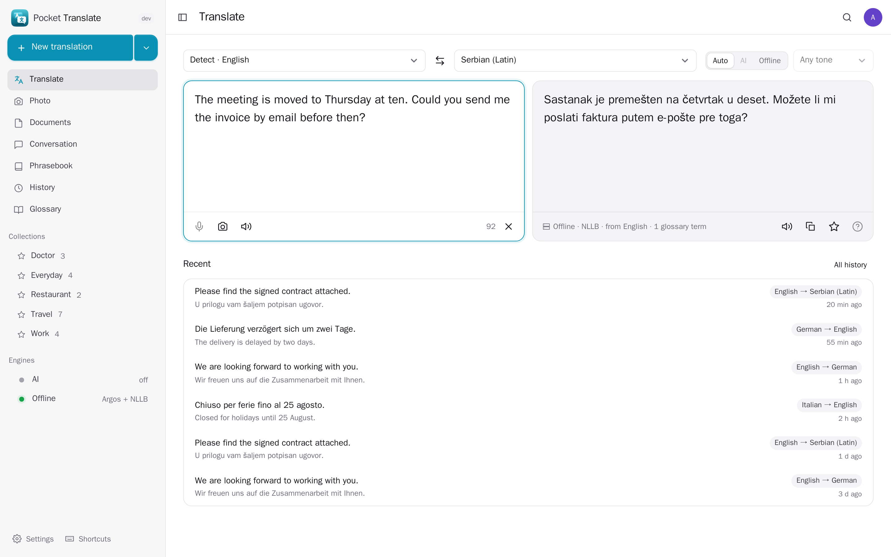
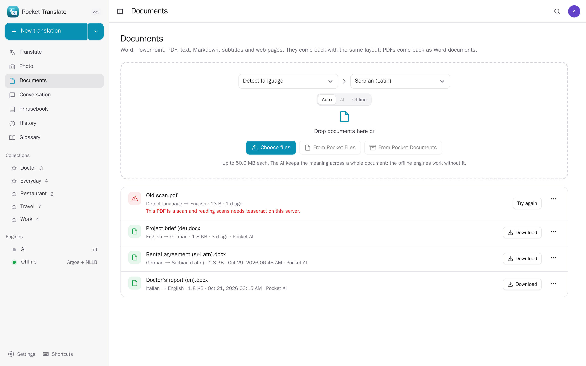
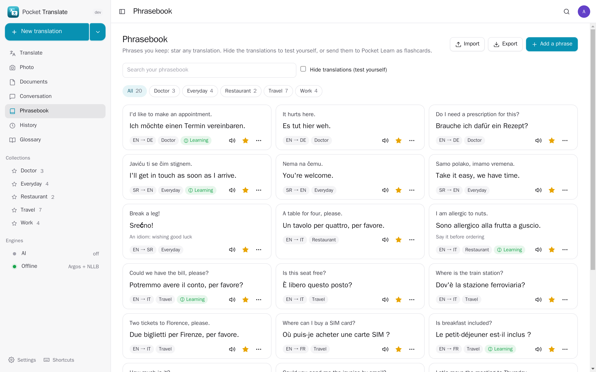
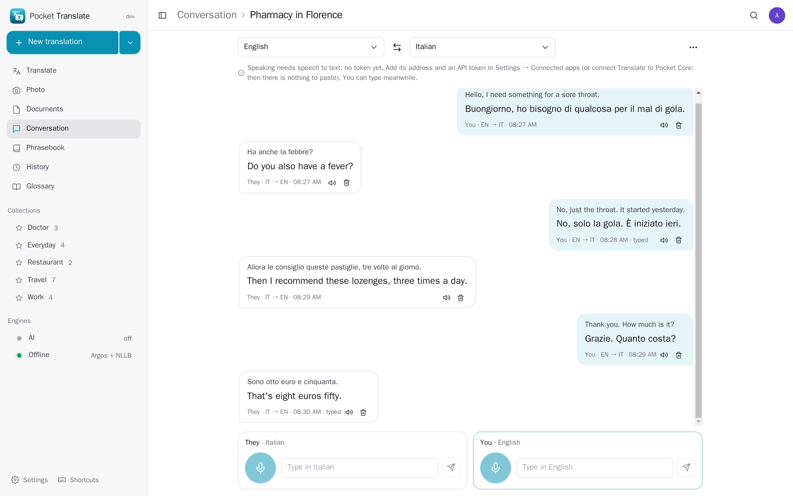
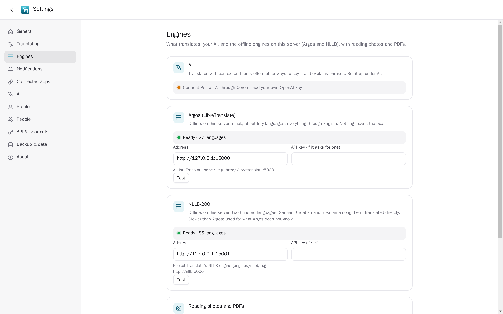
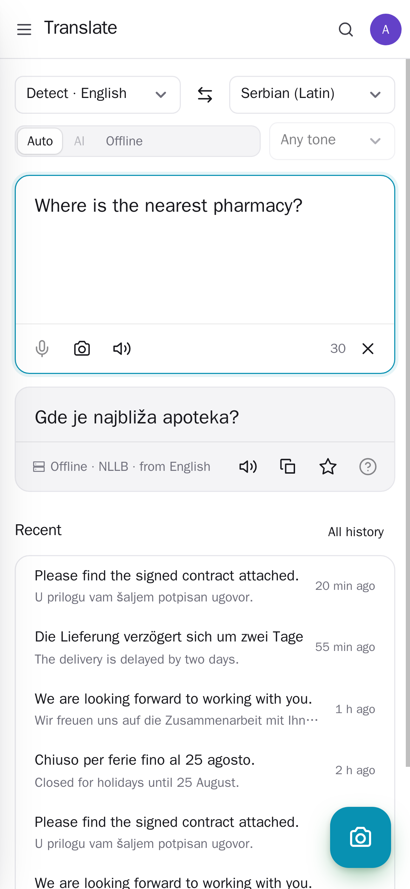
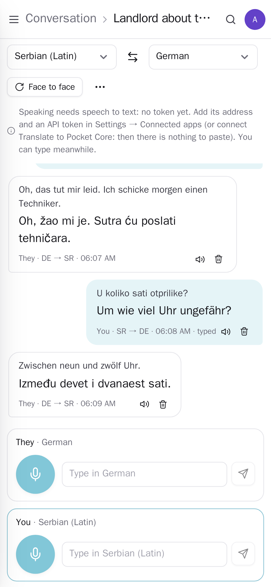

<p align="center"></p>
<h1 align="center">Pocket Translate</h1>
<p align="center">Translate text, photos, documents and conversations on your own server. Type or paste, photograph a menu or a sign, drop in a Word, PowerPoint or PDF file and get it back in the same layout, or talk with someone across two languages, each side read aloud. Pocket AI translates with tone and context; two offline engines on the box (Argos and NLLB-200, two hundred languages) work without it. A phrasebook, a glossary and your history, all your own.<br>One Go binary, one SQLite file, one volume. Part of the Pocket apps; works on its own too.</p>
<p align="center">
  <a href="https://github.com/abjelosevic88/pocket-homelab-translate/actions"></a>
  <a href="https://github.com/abjelosevic88/pocket-homelab-translate/pkgs/container/pocket-homelab-translate"></a>
  <a href="LICENSE"></a>
</p>

---

<p align="center"></p>

<table>
  <tr>
    <td width="50%"></td>
    <td width="50%"></td>
  </tr>
  <tr>
    <td align="center"><sub>Documents: Word, PowerPoint, PDF, subtitles, Markdown and web pages, translated in the background with their layout kept.</sub></td>
    <td align="center"><sub>The phrasebook: starred translations in collections, read aloud, hidden to test yourself, sent to Pocket Learn.</sub></td>
  </tr>
  <tr>
    <td width="50%"></td>
    <td width="50%"></td>
  </tr>
  <tr>
    <td align="center"><sub>A conversation: each side speaks, the other hears it in their language.</sub></td>
    <td align="center"><sub>The engines: your AI, and the offline ones on this server.</sub></td>
  </tr>
  <tr>
    <td width="50%"></td>
    <td width="50%"></td>
  </tr>
  <tr>
    <td align="center"><sub>On the phone: the camera button reads a photo.</sub></td>
    <td align="center"><sub>Face to face: the other person's half turns around, for a phone on the table.</sub></td>
  </tr>
</table>

## What it does

- **Text**: type or paste; the language is detected; Serbian comes in Latin or Cyrillic. The offline engines translate as you type; the AI when you press Translate, in the tone you ask for (formal or casual “you”), with other ways to say it and an **Explain** for idioms and phrases.
- **Photos**: a menu, a sign, a label, a letter. The text is read on the server (tesseract), you fix what it misread, and it is translated — keeping the lines of a menu.
- **Documents**: Word and PowerPoint come back with their formatting, tables, headers and footers; subtitles (SRT, WebVTT) with their timings; Markdown and web pages with their markup; PDFs (scans too) as a Word document. Translated in the background, one piece at a time, with progress; pick them from Pocket Files or Documents and put the translation back there.
- **Conversations**: two people, two languages. Each presses their microphone and speaks; it is written out (Pocket Voice, whisper on this server), translated and read aloud for the other. Face-to-face mode for a phone on the table. Keep it, save it as a note, download it.
- **Phrasebook**: star any translation; collections (Travel, Work, Doctor); your own corrections and notes; hide the translations to test yourself; send phrases to **Pocket Learn** as flashcards. Saved phrases from **Google Translate** come in from Takeout.
- **Glossary**: words always translated the same way — names, products, the terms your team uses — followed by the AI and the offline engines alike. Imports DeepL glossaries (CSV/TSV).
- **History**: everything you translated, by day, searchable; kept as long as you like, or not at all.
- **A LibreTranslate-compatible API** (`/translate`, `/detect`, `/languages`): browser extensions, apps and scripts made for LibreTranslate work with it; the API key is a Pocket Translate token.
- **Everyone their own** on one box: each person has their own history, phrasebook, glossary, documents and settings.

## The engines

| Engine | Where | Languages | Good at |
|---|---|---|---|
| Pocket AI (or your own OpenAI-compatible key) | Pocket Core | any | tone, context, idioms, glossary terms with the right endings, explanations |
| Argos ([LibreTranslate](https://github.com/LibreTranslate/LibreTranslate)) | this server | about 50, through English | quick |
| NLLB-200 ([engines/nllb](engines/nllb)) | this server | 200, directly (Serbian, Croatian, Bosnian among them) | languages Argos does not know |

**Auto** uses the AI when there is one and the offline engines otherwise — and when the AI does not answer, the offline engine translates and says so. **Offline** never sends text anywhere. For each pair the quickest offline engine that knows it is used. Glossary terms go through the offline engines as placeholders and come back as your words.

## Run it

[docker-compose.yml](docker-compose.yml) starts the app with both offline engines:

```sh
docker compose up -d
```

The first start downloads the language models (LibreTranslate a few GB, NLLB 1.4 GB). On its own:

```sh
docker run -d --name pocket-translate -p 8080:8080 -v ./data:/data \
  -e BASE_URL=https://translate.example.com -e SECURE_COOKIES=true \
  -e ARGOS_URL=http://libretranslate:5000 \
  ghcr.io/abjelosevic88/pocket-homelab-translate:latest
```

All options: [docs/configuration.md](docs/configuration.md). API: [docs/api.md](docs/api.md).

## With Pocket Core

Set `CORE_URL` and `CORE_REGISTRATION_KEY` and Translate joins the box: people sign in with Pocket Core, Pocket AI translates, and through app links it reaches the person's own Pocket apps with nothing to paste:

| App | What for | Without it | Scopes |
|---|---|---|---|
| Pocket Voice | speech in conversations and dictation, written out by whisper on this server | your own OpenAI key, or typing | `voice:transcribe` |
| Pocket Learn | phrases as flashcards | — | `learn:write` |
| Pocket Notes | a translation or a conversation as a note | download the conversation as text | `notes:write` |
| Pocket Files | pick a document, save the translation next to it | upload and download | `files:read`, `files:write` |
| Pocket Documents | pick a document from your archive, file the translation there | upload and download | `documents:read`, `documents:write` |
| Pocket AI | translating with tone and context, explaining; the Ask button on every page | your own OpenAI key, or the offline engines | inference |

**Nothing depends on another app.** Each app's state is checked per person, and what needs it is shown greyed out with one line saying why and what to do, never hidden.

Other apps use Translate through `translate:run` (Pocket Chat and Mail translate a message, Notes and Blog a page — with your engine, tone and glossary), `phrasebook:read` (Search, Pocket Day, Pocket AI) and `phrasebook:write` (save a phrase from another app). Events on the bus — `translate.phrase_saved`, `translate.document_done` — start flows in Pocket Flows.

## Develop

```sh
make dev     # API on :8080 with demo data + Vite on :5173
make test    # go vet, go test, tsc
make         # web + binary
```

`node scripts/screenshots.mjs` takes the screenshots above from a demo instance and fails on any browser error. MIT licensed.
